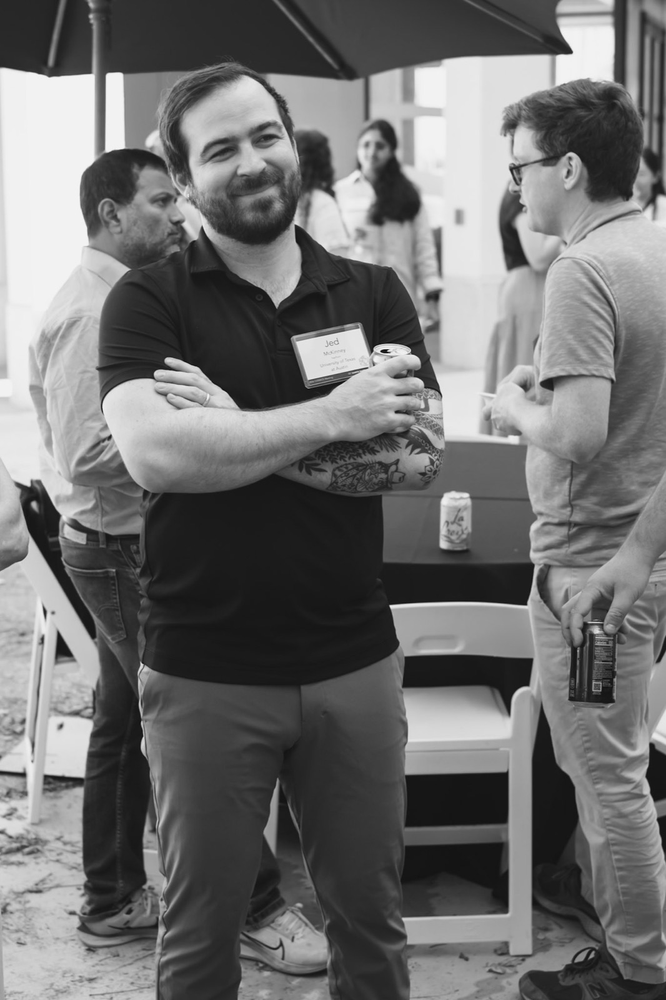

Photo courtesy of Henry Joy McCracken, taken at the 2026 COSMOS Meeting in Santa Barbara.
{: .caption}

My name is Jed McKinney and I am an astronomer. I use telescopes to observe galaxies far beyond our own Milky Way, delving deep into the gas and dust from which stars are born and black holes grow.

I am currently a NASA Hubble Fellow at the University of Texas at Austin. I achieved my PhD at The University of Massachusetts, Amherst and my bachelors degree at Tufts University.

I live in Austin, TX with my wonderful partner Zoe and our two cats Wanda and Goose. Outside of astronomy I am most likely cycling around Austin, or cooking in my kitchen while brewing a hot cup of speciality coffee.
