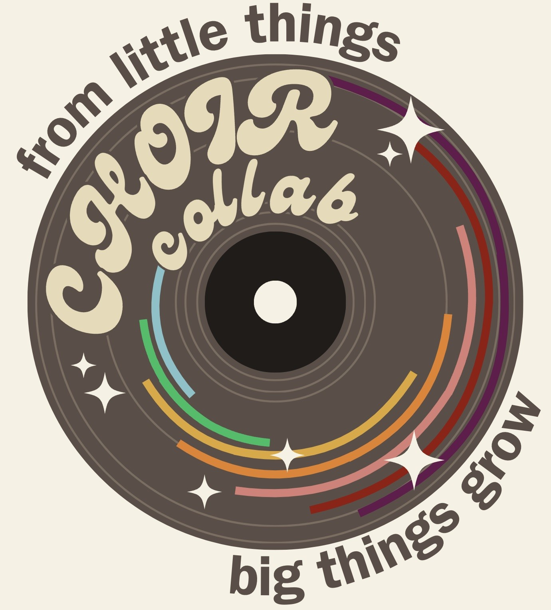

The [choir collaboration](https://www.choircollaboration.com/home) is a group of astronomers who challenge scientific and social paradigms. We organize on multiple fronts to bring about change in our research and communities. This includes hosting [conferences](https://www.choircollaboration.com/2025-conference), organizing grass roots mutual aid [initiatives](https://www.gofundme.com/f/mutual-aid-for-astronomy-and-space-sciences), and collaborating broadly across research areas. I have been a founding member of choir since its inception in 2024.

*The choir logo shown above was made by the very talented [Taylor Hutchison](https://aibhleog.github.io).*
