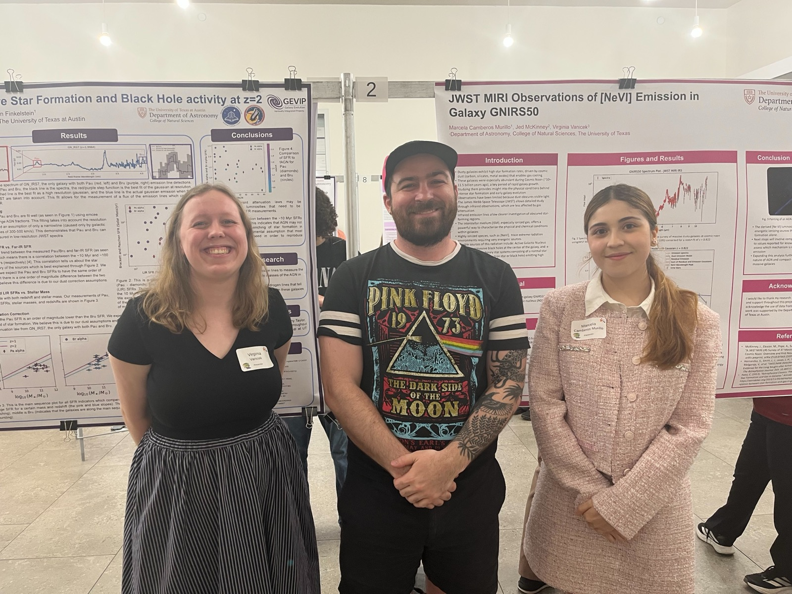

Virginia Vanicek (left) and Marcela Camberos Murillo (right) presenting their research on the LRS sample of z~1-2 dusty star-forming galaxy and AGN at UT Austin's Undergraduate Research Forum. Virginia is now a 1st year graduate student at UMd. Marcela is applying to grad school now.
{: .caption}

**Mentoring** is one of the most meaningful aspects of my day-to-day role as an Astronomer. Here is a list of my current and former mentees.

## Current Mentees

- **Miriam Eleazer**, UMass grad
- **Virginia Vanicek**, Former UT undergrad, now 1st year grad student at UMd with the NSF GRFP.
- **Cassidy Novack**, Former Whitman undergrad and UT summer research student, now post-bacc at NRAO.
- **Marcela Camberos Murillo**, UT undergrad
- **[Dhruv Zimmerman](https://astro.ufl.edu/directory/dhruv-zimmerman/)**, UF grad working with me at UT for a 6 month pre-doc
- **Elaine Gammon**, UGA undergrad and UT REU, now NSF GRFP @ UW
{: .people}

## Former Mentees (years working together)

- **[Olivia Cooper](https://0cooper.github.io/#about)**, NSF AAPF @ CU Boulder (2023-2025)
- **[Lindsay R. House](https://lindsay.house)**, SkAI Preceptor (2024-2025)
- **Camila Silva**, UChicago undergrad and UT REU, now grad @ UCSD (2024-2025)
- **Leo Sajkov**, Tufts undergrad (2023-2024)
- **Meredith Stone**, UArizona grad student (2018-2024)
- **Rucellie Jimenez**, UMass undergrad (2021-2022)
- **Owen Henry**, UMass undergrad (2019-2020)
{: .people}

## Near-Peer Network

Through organizations like [choir](https://www.choircollaboration.com/home) and [COSMOS](https://cosmos.astro.caltech.edu) I have the pleasure of working with incredible early-career postdocs and junior faculty. Here is a list of my closest scientific collaborators. Please check them and their work out!

- [Prof. Arianna Long](https://astro.washington.edu/people/arianna-long) (UW)
- [Dr. Erini Lambrides](https://erinilambrides.com) (NASA Goddard)
- [Prof. Sinclaire Manning](https://sinclairemanning.com) (UMass)
{: .people}
