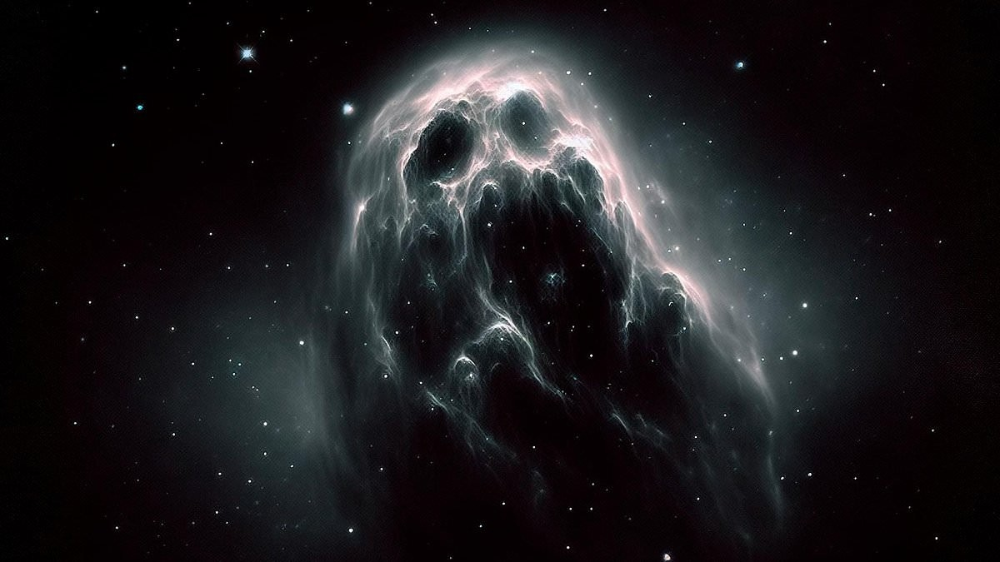

## Ghostlike Galaxy Reappears

A paper I wrote on a "monster galaxy" was featured in a UT Austin press-release. The article can be found [here](https://news.utexas.edu/2023/12/04/ghostlike-dusty-galaxy-reappears-in-james-webb-space-telescope-image/), and it spurned some interesting AI artwork evocative of hidden monsters in the dark, which this galaxy surely is. *Image credits: Scitechdaily.com*

---

## Astronomy on Tap, ATX

I co-host Austin's [Astronomy on Tap](https://www.aotatx.org). We bring astronomy to the local ATX community by hosting public-oriented science talks in breweries. Check out our recorded lectures [here](https://www.youtube.com/@AstronomyonTapATX/videos). Because science is better with beer!

---

## Paradise Is... A Starry Night | Paradise City Podcast Feature

I was interviewed by Sylvia for her podcast [Paradise City](https://paradisecitypodcast.com). We talked about the cosmos and community. Listen to [Paradise Is... A Starry Night](https://open.spotify.com/episode/3GlZkqzdpoPu5nzCur9l0C) to hear the full story.

---

## IA-FORTH Remote Seminar

<iframe src="https://www.youtube-nocookie.com/embed/9bx8puXkTi8?rel=0" title="IA-FORTH Remote Seminar" allowfullscreen loading="lazy"></iframe>

Introduced by my good friend Tanio Diaz-Santos, this was a fun talk to give as I was counting down the minutes to my first observations with JWST.
