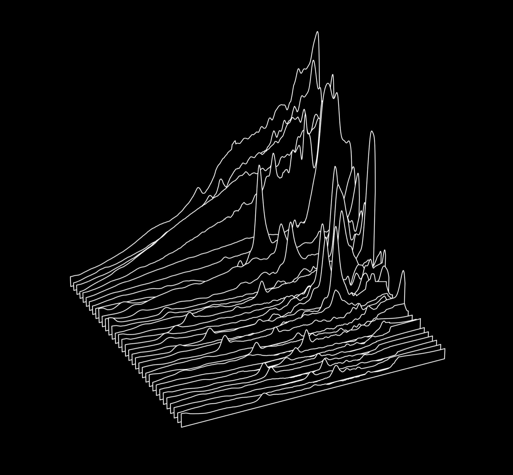
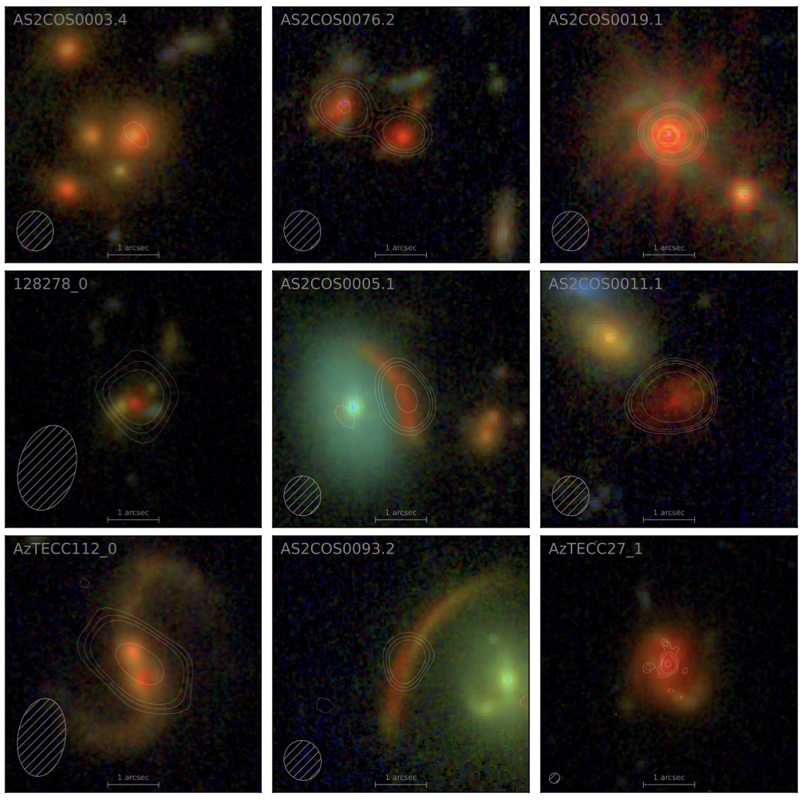

Below you can find code, data, and other resources my students and I have built. If you have a question about anything posted here, or trouble getting code running, please don't hesitate to email me.

<!--
  HOW TO ADD AN ENTRY: copy everything from 

  down to its matching 
, paste it below the last entry, and change the
  image, heading, text, and link. Leave a blank line before and after the
  text inside the box. An entry without an image works too: just delete
  the line that starts with  galaxy SED-fitting code with an optional supernova dust attenuation law, for modeling galaxies in the early Universe. This is the code used in [McKinney et al. (2025)](https://arxiv.org/abs/2502.14031). If making use of this Bagpipes version, please cite [McKinney et al. (2025)](https://arxiv.org/abs/2502.14031), [Carnall et al., (2018)](https://arxiv.org/abs/1712.04452), and [Carnall et al., (2019b)](https://arxiv.org/abs/1903.11082).  

[Get the code on GitHub](https://github.com/jed-mckinney/bagpipes-sne-dust)

## cortado

A mid-infrared spectroscopic decomposition code, built on the heritage of similar tools like [CAFE](https://github.com/GOALS-survey/CAFE) and [PAHFIT](https://github.com/PAHFIT/pahfit). cortado is a lighter version of these models, optimized for spectro-photometric fitting of high-redshift galaxies usually with R~100 spectra. 
This is the code used in the revised version of [McKinney et al. (2026)](https://arxiv.org/abs/2510.07365) as described in the erratum, and the updated arXiv posting. If using this code, please cite [McKinney et al. (2026)](https://arxiv.org/abs/2510.07365). 

[Get the code on GitHub](https://github.com/jed-mckinney/cortado)

## Mid-infrared templates

Combined JWST MIRI LRS and Spitzer IRS spectra of z~1-2 massive, dust-obscured star-forming galaxies, described in [McKinney et al. (2026)](https://arxiv.org/abs/2510.07365). Data are available on request; please email me. Templates constructed from stacks of this sample will be made available soon. 

## SCUBADive Data Products

JWST and ALMA data for 289 sub-millimeter galaxies observed with JWST and ALMA in the COSMOS-Web field, described in [McKinney et al. (2025)](https://arxiv.org/abs/2408.08346). Data are available on request; please email me.

