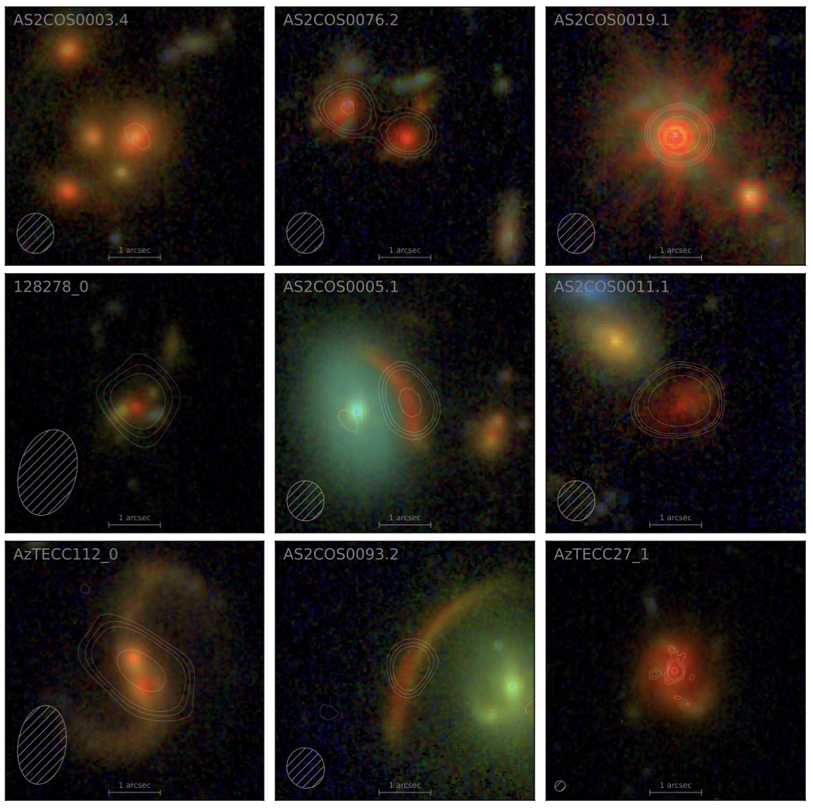
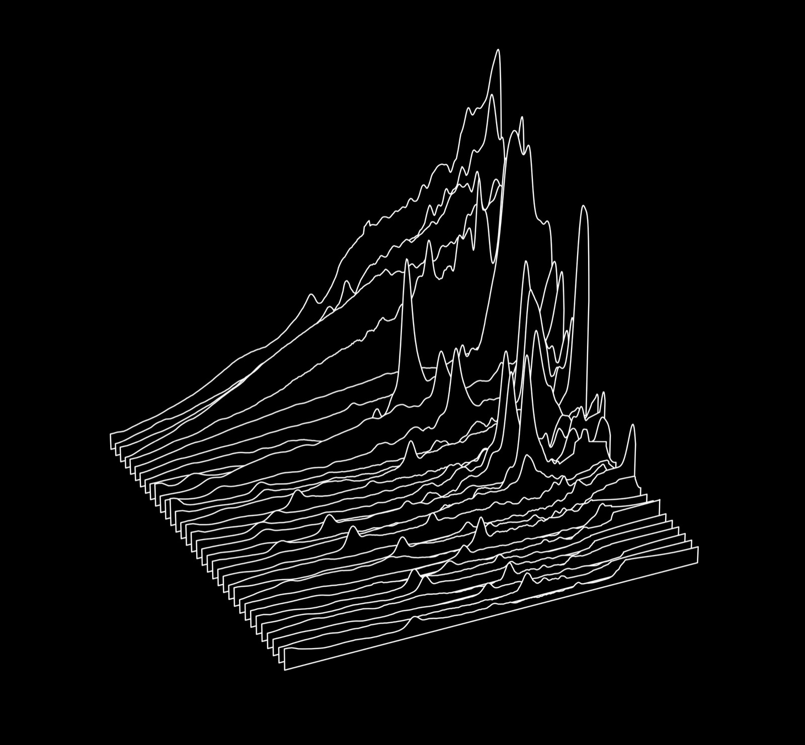
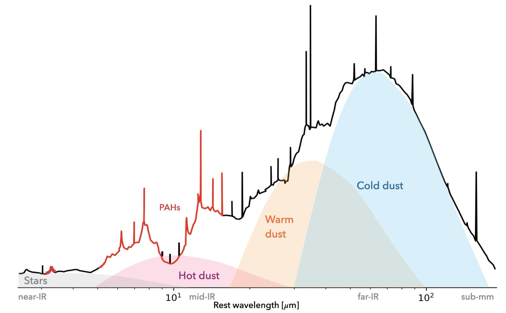

I am an observational astronomer who uses telescopes like JWST, ALMA, and the VLA to uncover the gas and dust from which stars are born and black holes grow. Much of my work happens at infrared and radio wavelengths, where dust-obscured star formation and black hole accretion are revealed. In collaboration with my theorist colleagues, I also use simulations to test and refine our theories of dust. 

## Focus & Goals

Massive stars burn bright and fast. In their death throes they scatter metals into interstellar gas, and seed the formation of dust. Accrued through generations of star formation, dust sets the multi-phase structure of gas, locks away heavy elements, and sets the seeds for star- and planet-formation. The effects of dust touch nearly every aspect of astronomy, and beyond. Dust can sour your coffee, and even killed the dinosaurs. 

My research group and I work at the intersection of dust and galaxy formation, focusing on questions like: 

- How much star-formation and black hole accretion is obscured by dust in galaxies near and far? 
- How does dust change with cosmic time and galaxy properties? 
- When does dust become a significant component of galaxies? 
- How does dust made by supernovae change our picture of galaxies in the early Universe?

## Dust-Obscured Galaxies with JWST & ALMA

Combined JWST (RGBs) and ALMA (contours) observations of dust-obscured galaxies at high-redshift. Prior to JWST these galaxies typically lacked optical detection. Now we not only detect but spatially resolve their stellar light, revealing diverse morphologies buried within the most active galaxies in the Universe.

For a full description of the work and visualization of the complete sample see [the SCUBADive paper](https://arxiv.org/abs/2408.08346). SCUBADive is an ongoing project to catalog and characterize dust-obscured galaxies using JWST and ALMA. Please reach out if you are interested in working with us, and the data can be made available.

This project was made possible by [COSMOS-Web](https://cosmos.astro.caltech.edu/page/cosmosweb), a 255 hour JWST program surveying 0.6 square degrees of the sky with NIRCam and MIRI. SCUBADive contains the most massive and active galaxies from over 800,000 found in the COSMOS-Web field.

## Infrared Spectroscopy with JWST

Spectroscopy is a powerful tool to study the physical conditions of stars, growing black holes, and interstellar gas. I specialize in infrared and radio spectroscopy using telescopes like JWST, ALMA, and the VLA to measure atomic and molecular emission lines. My research stems from a rich history of infrared astronomy and past missions like Spitzer, Herschel, and ISO.

In Cycle 2 [I was awarded 40 hours of time on JWST](https://www.stsci.edu/jwst/science-execution/program-information?id=3224) to take 5-14um spectra of galaxies 10 billion light years away. This data, illustrated above, is teaching us about dust molecules that shield young star-forming regions from the intense radiation fields generated by previous generations of stars. Without this dust the gas in a galaxy would otherwise be far too hot for further generations of stars to form.

The visualization of my spectra above is inspired by the album cover art of Joy Division's Unknown Pleasures, which itself was inspired by Jocelyn Bell Burnell's discovery of pulsar radiation in 1967 and then Harold Craft Jr's visualizations of pulsar signals in 1970. For a concise summary of this history see [this article](https://blogs.mathworks.com/graphics-and-apps/2024/01/10/creating-ridgeline-plots-from-pulsars-to-pop-culture/).

My students/mentees and I worked hard to calibrate, reduce, and analyze these data. The [survey overview paper](https://ui.adsabs.harvard.edu/abs/2025arXiv251007365M/abstract) is now published.

## PRIMA: A New Infrared Perspective

The infrared is a rich regime of the electromagnetic spectrum host to bright signatures of star-formation, supermassive black hole accretion, and the molecular gas in galaxies. I use telescopes like JWST and ALMA to spectroscopically and photometrically characterize these galaxy components. By targeting galaxies near and far I work with my collaborators to understand how over time cold gas is transformed into stars and supermassive black holes, and how in turn, these energetic processes shape the future of gas consumption.

I am a science affiliate and Galaxy Evolution Working Group co-lead for [The PRobe far-Infrared Mission for Astrophysics](https://prima.ipac.caltech.edu), or PRIMA for short. PRIMA was recently selected by NASA to advance to Phase B. This cryogenically-cooled, far-infrared space observatory could be launched as early as 2033. PRIMA will fill the observing gap between JWST's longest wavelength coverage and ALMA's shortest.

## Recent Publications

- **McKinney et al. (2026)** — Simulation-Informed Dust Masses in Typical 6\<z\<14 JWST Galaxies. [arXiv:2610.37821](https://arxiv.org/abs/2610.37821)
- **McKinney et al. (2026)** — JWST Reveals a Candidate Supermassive Black Hole Binary at z=4.3 in the Brightest Sub-millimeter Galaxy in COSMOS-Web. [arXiv:2609.01711](https://arxiv.org/abs/2609.01711)
- **McKinney et al. (2026)** — A JWST MIRI LRS Survey of 37 Massive Star-Forming Galaxies and AGN at Cosmic Noon: Overview and First Results. [arXiv:2510.07365](https://arxiv.org/abs/2510.07365)
- **McKinney et al. (2025)** — Modeling Galaxies in the Early Universe with Supernova Dust Attenuation. [arXiv:2502.14031](https://arxiv.org/abs/2502.14031)
- **McKinney et al. (2025)** — SCUBADive I: JWST+ALMA Analysis of 289 Sub-millimeter Galaxies in COSMOS-Web. [arXiv:2408.08346](https://arxiv.org/abs/2408.08346)
{: .pubs}

See the [full list of my first-author papers on NASA ADS](https://scixplorer.org/public-libraries/wAKdA6D2Rom2042mhvYkow).
